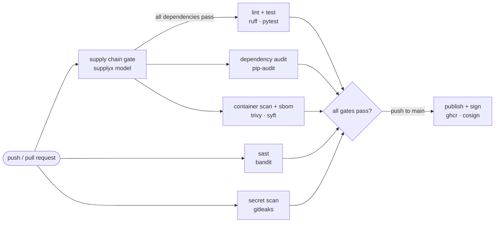

# Supplyx Flask Demo

A small Flask API whose CI pipeline scores every dependency with the
[Supplyx](https://github.com/joshuaalwin/Supplyx) malicious-package model before
anything installs it. Push a change that adds a malicious-looking dependency and the
build stops, with the reasons.

## Pipeline



| job | tool | purpose |
|-----|------|---------|
| supply chain gate | Supplyx (XGBoost, 13 behavioural signals) | blocks dependencies that behave like malware, including ones with no CVE yet |
| sast | bandit | insecure code patterns |
| secret scan | gitleaks | committed credentials |
| lint + test | ruff, pytest | code hygiene and unit tests |
| dependency audit | pip-audit | known CVEs in dependencies |
| container scan + sbom | trivy, syft | image vulnerabilities and a bill of materials |
| publish + sign | cosign | push to GHCR, keyless-sign, attach a signed SBOM |

The jobs that install dependencies wait for the supply chain gate, so a blocked
package never runs its install script on a runner.

## How the gate works

`python -m supplyx.scan requirements-dev.txt`

1. Reads the requirements files (following `-r` includes).
2. Downloads each dependency's source archive straight from PyPI, or reads a local
   archive. Nothing is installed, so no package code runs.
3. Unpacks it with path-traversal and size checks.
4. Extracts 13 signals: network calls or `exec` on decoded data in install scripts,
   obfuscation, download-then-execute patterns, typosquatted names, and more.
5. Scores it with the Supplyx model and fails the build at a score of 0.6 or above,
   printing the signals that drove the score (TreeSHAP contributions).

## Try it

The `demo/malicious-dependency` branch adds one line to `requirements.txt` pointing at
`vendor/reqeusts-9.9.9.tar.gz`, a typosquat of `requests` whose `setup.py` looks like
an install-time dropper.

```bash
git push origin demo/malicious-dependency
```

The supply chain gate fails and the install jobs are skipped:

```
  ok     0.083  low       Flask==3.1.3
  ok     0.317  medium    gunicorn==26.2.0
  BLOCK  1.000  critical  reqeusts==9.9.9
         why: looks like 'requests'; exec/eval on decoded or downloaded data (+2.07);
              network call in install script (+1.96); ...
```

The fixture is inert. Its payload sits behind `if False` and never runs, and the
address in it is a reserved documentation range (RFC 5737). It exists so the scanner
has something realistic to read.

## Run locally

```bash
python -m venv .venv && source .venv/bin/activate
pip install -r requirements-dev.txt -r supplyx/requirements.txt
python -m supplyx.scan requirements-dev.txt   # the gate
ruff check . && pytest -q
python src/app.py                             # api on http://127.0.0.1:8000
```

## Limits

- Only the dependencies listed in the requirements files are scored, not their
  transitive dependencies.
- The scanner's own dependencies (`supplyx/requirements.txt`) are not scored by it.
- The model reports 97.7% precision and 83.7% recall on its held-out test set, so it
  will miss some malicious packages. It complements `pip-audit`; it does not replace it.

## Credits

The model and feature extractors come from Supplyx, built by Joshua Alwin and
Nimal Kurien Thomas.
